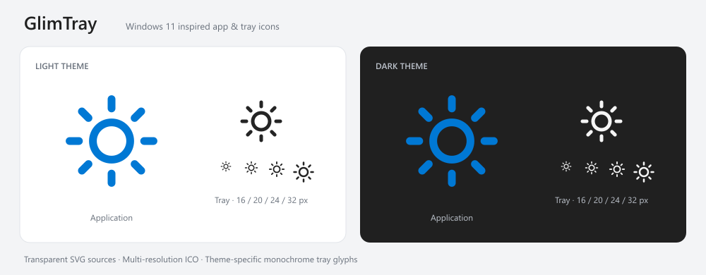

# GlimTray · 微光

使用 Rust + Slint 开发的轻量 Windows 显示器控制工具。

当前已接入 Windows 外接显示器枚举、DDC/CI 亮度读取与调节、系统托盘、手动刷新和开机自启。笔记本内屏 WMI 控制、快捷键和定时调节尚未实现。

## 使用

1. 运行 `cargo run --locked`，应用启动后留在系统托盘，只枚举和读取显示器，不会自动改变亮度。
2. 左击托盘图标，在任务栏附近直接展开亮度面板。拖动滑块即可调节；点击外部、按 Esc 或再次左击托盘可收起。
3. 面板和主界面共享显示器与亮度状态，后台合并连续请求并读取显示器返回的实际值。每次展开面板会重新读取设备。
4. 插拔显示器或设备状态变化后点击“刷新”。无法读取亮度的设备会显示原因并禁用滑块。
5. 右键托盘可打开主界面、刷新或退出。托盘图标跟随 Windows 系统任务栏的深浅主题。
6. 在主界面打开“开机自启”，下次登录 Windows 时自动驻留托盘。开关读取当前程序的注册状态，默认不会主动启用；关闭开关会移除 GlimTray 的启动项。

自启使用当前用户的 Windows `Run` 注册项，保存带引号的程序完整路径，无需管理员权限。移动程序后，需要从新位置重新开启自启。

亮度调节时只更新百分比，滑块位置保持固定。连接路径、DDC/CI 标记和普通状态提示不在界面中展示；无法控制的设备仍会显示错误原因。

只读诊断命令：

```powershell
cargo run --locked -- --list
```

诊断输出 JSON，包含本次枚举的设备标识、名称、连接和亮度。标识只在本次枚举期间有效，不能作为长期配置中的固定设备 ID。

DDC 操作位于隐藏子进程中。刷新响应超时设为 8 秒，亮度响应超时设为 3 秒；超时会结束控制进程并禁用控制，刷新后可重试。界面线程不等待显示器调用。

真实亮度变化、扩展坞兼容性和休眠恢复需要在实际设备上验收。自动验证只执行读取，不会修改屏幕亮度。

## 图标



图标采用接近 Windows 11 系统状态图标的简洁线条。蓝色应用图标已接入窗口和 Windows 可执行文件；黑白托盘素材提供深浅主题两个版本，见 `assets/icons/README.md`。

## 开发环境

- Windows x64、Rust stable（MSVC 工具链）。
- Visual Studio C++ 构建工具和 Windows SDK。
- VS Code 打开仓库后，在扩展面板中搜索 `@recommended`，安装工作区推荐扩展。

| 扩展 | 用途 |
| --- | --- |
| rust-analyzer | Rust 补全、诊断和格式化 |
| Slint | `.slint` 补全、格式化和实时预览 |
| CodeLLDB | F5 调试 Rust 程序 |
| Even Better TOML | Cargo 配置补全和格式化 |
| Code Spell Checker | 英文拼写检查，项目词典见 `cspell.json` |

扩展推荐只写入仓库配置，不会自动安装扩展或修改用户级设置。

## 常用命令

```powershell
cargo run --locked
cargo check --locked
cargo test --locked
cargo clippy --locked --all-targets -- -D warnings
cargo fmt --all -- --check
cargo build --release --locked
./scripts/package.ps1
```

首次构建会下载并编译依赖。当前使用 Winit + FemtoVG 渲染后端，并保留无障碍和系统托盘支持。

Release 配置采用体积优先优化、完整 LTO、单代码生成单元和符号剥离；发生 panic 时直接终止进程。Windows x64 静态链接 CRT，不需要额外安装 VC++ Redistributable。本地实测 EXE 从 12.55 MiB 减至 8.33 MiB，减少约 33.6%。实际体积会随编译器和依赖版本变化。

在 VS Code 中，`Ctrl+Shift+B` 构建，`F5` 使用 CodeLLDB 调试；也可运行 `.vscode/tasks.json` 中的 Cargo 任务。

## 自动构建与发布

GitHub Actions 在推送 `main`、向 `main` 提交 PR 和推送 `v*` tag 时运行检查与 Windows x64 构建，产物可在 Actions 的 Artifacts 下载。

仅版本 tag 可以创建 GitHub Release，并且必须同时满足：

1. tag 对应的提交属于远端 `main` 的历史，且构建的正是该提交。其他分支尚未合入 `main` 的提交会被拒绝。
2. tag 为 `v0.1.0` 或 `v0.1.0-rc.1` 等版本格式，去掉 `v` 后必须与该提交的 `Cargo.toml` 版本完全一致。
3. 发布校验、格式检查、Clippy、测试和 Release 构建全部成功。

普通推送和 PR 只生成构建产物，不创建 Release。带 `-rc.1` 等后缀的 tag 创建预发布版。发布附件包含便携 ZIP（`glimtray.exe` 和 README）及 `SHA256SUMS.txt`。

例如发布当前 `0.1.0` 版本，在代码已提交并推送到 `main` 后执行：

```powershell
git switch main
git pull --ff-only origin main
git tag -a v0.1.0 -m "GlimTray v0.1.0"
git push origin v0.1.0
```

后续版本先修改 `Cargo.toml`，通过 Cargo 更新并提交 `Cargo.lock`，再合入 `main`、推送对应 tag。工作流使用仓库自动提供的 `GITHUB_TOKEN`，只有发布 job 具有 `contents: write` 权限。

本地可运行 `./scripts/test-release-guard.ps1` 验证发布限制。测试只在临时仓库中创建 tag，不会给当前项目打 tag。

## 目录

```text
src/main.rs          应用、只读诊断及控制子进程入口
src/app.rs           UI 状态、异步更新和托盘生命周期
src/flyout_window.rs  托盘浮层、失焦收起和窗口属性
src/flyout.rs         浮层定位与点击切换规则
src/native.rs        Windows 枚举、亮度接口和物理句柄管理
src/display.rs       显示器快照及亮度范围换算
src/queue.rs         写入合并和过期响应处理
src/startup.rs       当前用户开机自启注册、读取和移除
src/worker/          子进程协议、超时管理和后台调度
ui/app-window.slint  主界面、亮度浮层、共享滑块模型和托盘菜单
build.rs             编译 Slint 界面
assets/icons/        应用和托盘图标，含 SVG 源文件、PNG、ICO 和预览
.vscode/             工作区扩展推荐、设置、任务和调试配置
.cargo/config.toml   Windows 链接配置
cspell.json          项目拼写词典
scripts/            发布校验、校验测试和便携 ZIP 打包
.github/workflows/  Windows 检查、构建及 main 版本 tag 发布
```

`target/`、`dist/` 和 `work/` 已加入 `.gitignore`；`Cargo.lock` 和 `.vscode/` 保留在版本控制中，便于复现依赖和共享开发配置。
